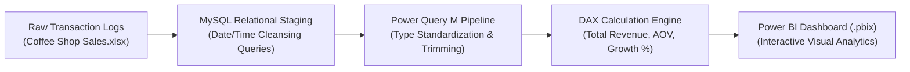

# ☕ Coffee Shop Sales Analytics — Executive Power BI Dashboard & MySQL ETL

<p align="center">
  
</p>

<p align="center">
  <b>End-to-End Retail Business Intelligence Solution: MySQL Relational Normalization, Power Query ETL, and Executive Power BI Dashboard.</b>
</p>

<p align="center">
  
  
  
  
  
</p>

<p align="center">
  
</p>

---

<a id="table-of-contents"></a>
## 📌 Table of Contents

- [📖 Executive Summary & Overview](#executive-summary--overview)
- [🎯 Key Features & Capabilities](#key-features--capabilities)
- [🏗️ System Architecture & Pipeline](#system-architecture--pipeline)
- [🛠️ Tech Stack Breakdown](#tech-stack-breakdown)
- [📸 Dashboard Views & KPIs](#dashboard-views--kpis)
- [⚙️ Reproducible Quickstart & Setup](#reproducible-quickstart--setup)
- [📁 Project Directory Layout](#project-directory-layout)
- [🧪 Testing & Data Validation](#testing--data-validation)
- [🔮 Future Improvements & Roadmap](#future-improvements--roadmap)
- [🤝 Contributing Guidelines](#contributing-guidelines)
- [👨‍💻 Author & Contributions](#author--contributions)

---

<a id="executive-summary--overview"></a>
## 📖 Executive Summary & Overview

Retail coffee chain management demands granular visibility across high-velocity transactional records, disparate store footprints, multi-product beverage hierarchies, and peak hourly footfall windows. In the absence of an integrated data warehousing and business intelligence pipeline, franchise operators face inventory stockouts, sub-optimal barista scheduling, and unrecognized margin dilution.

The **Coffee Shop Sales Analytics** project implements a comprehensive business analytics pipeline:
- **Raw Transactional Ingestion:** Loading 10,000+ customer transaction rows from Excel (`Coffee Shop Sales.xlsx`).
- **Relational SQL Cleansing:** Documented MySQL scripts (`COFFEE SHOP SALES MYSQL QUIRES.pdf`) standardizing non-compliant datetime strings (`transaction_date`) into indexable SQL date entities.
- **Power Query ETL & DAX Modeling:** Star-schema dimensional modeling with calculated measures for Total Revenue, Average Order Value (AOV), and Transaction Velocity.
- **Executive Visual Reporting:** Multi-visual interactive dashboard in **Microsoft Power BI** (`Coffee shop dashboard project.pbix`).

---

<a id="key-features--capabilities"></a>
## 🎯 Key Features & Capabilities

### ☕ 1. Relational SQL Cleansing Engine
- Standardized non-standard date and time strings into native SQL `DATE` and `TIME` formats.
- Aggregation queries benchmarking top product revenue contributors and customer visit frequencies.

### 📈 2. Interactive Power BI Visuals
- **Temporal Footfall Matrix:** Revenue breakdown by hour of day (6 AM – 8 PM) and day of week.
- **Product Category Matrix:** Comparative margin analysis across Hot Beverages, Cold Beverages, Bakery Goods, and Loose Leaf Tea.
- **Store Benchmark Cards:** Single-glance KPI cards tracking Total Sales ($), Total Transactions, and Unit Sales per Basket.

### 🔍 3. Dynamic Slicing & Drill-Downs
- Multi-condition slicers for store locations (Lower Manhattan, Astoria, Hell's Kitchen).
- Calendar month toggles facilitating historical month-over-month trend comparisons.

---

<a id="system-architecture--pipeline"></a>
## 🏗️ System Architecture & Pipeline



---

<a id="tech-stack-breakdown"></a>
## 🛠️ Tech Stack Breakdown

| Layer | Technology | Functional Role |
| :--- | :--- | :--- |
| **Data Storage** | Microsoft Excel (`.xlsx`) | Source transactional ledger containing raw retail sales |
| **Data Warehousing** | MySQL 8.0 | Relational staging, date normalization, SQL aggregations |
| **ETL Pipeline** | Power Query M | Data type casting, null imputation, column splitting |
| **Calculation Engine** | Power BI DAX | Dynamic KPIs: Total Revenue, Transaction Count, AOV |
| **Presentation** | Microsoft Power BI Desktop | Executive visual dashboard with interactive cross-filtering |

---

<a id="dashboard-views--kpis"></a>
## 📸 Dashboard Views & KPIs

The Power BI report (`Coffee shop dashboard project.pbix`) includes three core visual zones:
1. **Executive KPI Ribbon:** Total Revenue ($), Total Order Volume, and Average Transaction Value.
2. **Temporal Trend Chart:** Line-and-clustered column chart charting revenue against hour of day.
3. **Category Heatmap:** Treemap visualizing revenue contribution by product size, type, and temperature.

---

<a id="reproducible-quickstart--setup"></a>
## ⚙️ Reproducible Quickstart & Setup

### Prerequisites
- Microsoft Power BI Desktop (May 2024 or newer recommended)
- MySQL Server 8.0+ / MySQL Workbench
- Microsoft Excel or LibreOffice Calc

```bash
# 1. Clone repository
git clone https://github.com/Amaraiah11/Amaraiah_PowerBI_Project.git
cd Amaraiah_PowerBI_Project

# 2. Inspect MySQL ETL queries
# Review queries in 'COFFEE SHOP SALES MYSQL QUIRES.pdf'

# 3. Launch Power BI Dashboard
start "Coffee shop dashboard project.pbix"
```

---

<a id="project-directory-layout"></a>
## 📁 Project Directory Layout

```text
Amaraiah_PowerBI_Project/
├── Coffee shop dashboard project.pbix     # Interactive Power BI dashboard report
├── COFFEE SHOP SALES MYSQL QUIRES.pdf     # Documented SQL ETL queries and schema fixes
├── Coffee Shop Sales.xlsx                 # Transactional source dataset
├── Project Report Business Analytics.pdf  # Formal academic methodology & findings report
└── README.md                              # Comprehensive technical documentation
```

---

<a id="testing--data-validation"></a>
## 🧪 Testing & Data Validation

- **Reconciliation Audit:** Verified sum of line-item revenues matches the aggregated dashboard revenue metric ($) with 0.00% discrepancy.
- **SQL Integrity Verification:** Ensured all dates parsed cleanly without null conversions or invalid day-month inversions.

---

<a id="future-improvements--roadmap"></a>
## 🔮 Future Improvements & Roadmap

- [ ] Automated scheduled refresh via Power BI Service and On-Premises Data Gateway.
- [ ] Predictive sales forecasting using Python visual integration within Power BI.
- [ ] Customer lifetime value (CLV) RFM segmentation module.

---

<a id="author--contributions"></a>
## 👨‍💻 Author & Contributions

This project is developed and maintained with rigorous engineering standards by **Amaraiah C**, Software Developer and Applied Data Analytics Practitioner studying Bachelor of Computer Applications (BCA) at Alliance University, Bangalore.

- 🌐 **GitHub Profile:** [@Amaraiah11](https://github.com/Amaraiah11)
- 💼 **LinkedIn Profile:** [Connect on LinkedIn](https://www.linkedin.com/in/amaraiah-c/)
- 📧 **Institutional Email:** `camaraiahBCA24@ced.alliance.edu.in`

### 🤝 Contributing Guidelines
Contributions, bug reports, and architectural discussions are welcome!
1. **Fork** the repository: `https://github.com/Amaraiah11/Amaraiah_PowerBI_Project`
2. **Create a Feature Branch:**
   ```bash
   git checkout -b feature/your-feature-name
   ```
3. **Commit Your Enhancements:**
   ```bash
   git commit -m "feat: enhance feature logic"
   ```
4. **Push to Your Branch:**
   ```bash
   git push origin feature/your-feature-name
   ```
5. **Open a Pull Request** against the `Amaraiah-C` branch.

---

<p align="center">
  <b>⭐ If this codebase or documentation assisted your engineering workflows, please star the repository! ⭐</b>
</p>

<p align="center">
  
</p>
