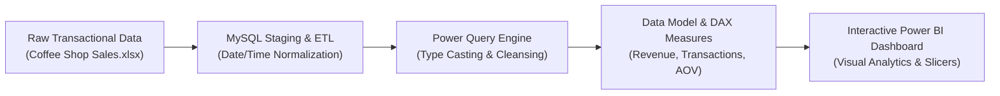

<p align="center">
  
</p>

<p align="center">
  
  
  
  
  
</p>

<a id="overview"></a>
## 📖 Executive Summary & Overview

The **Coffee Shop Sales Analytics** project provides an end-to-end business intelligence solution addressing the operational visibility challenges of multi-location retail coffee chains. Retail beverage operations produce high-velocity transactional records across store locations, product lines, and hourly operating windows. Without structured aggregation, identifying revenue bottlenecks, inventory underperformance, and peak footfall hours is unfeasible.

This project implements a multi-step data pipeline: raw transactional ingestion from Excel, relational normalization and data cleansing through **MySQL scripts**, data modeling via **Power Query**, and an interactive, executive-grade dashboard built in **Microsoft Power BI**.

<a id="toc"></a>
## 📑 Table of Contents

- [📖 Executive Summary & Overview](#overview)
- [🎯 Key Features & Capabilities](#features)
- [🏗️ System Architecture & Pipeline](#architecture)
- [🛠️ Tech Stack Breakdown](#tech-stack)
- [⚙️ Reproducible Quickstart & Setup](#setup)
- [📁 Project Directory Layout](#project-layout)
- [👨‍💻 Author & Contributions](#author)

<a id="features"></a>
## 🎯 Key Features & Capabilities

- **Relational SQL Cleansing:** Structured SQL queries transforming irregular date representations (`transaction_date`) into standard SQL datetime formats, enabling temporal window functions.
- **Temporal Footfall Analysis:** Granular revenue tracking segmented by weekday, month, and hourly intervals to uncover peak sales periods.
- **Product Category Matrix:** Cross-category comparisons across coffee blends, bakery items, tea, and retail merchandise.
- **Location-Based Performance Metrics:** Comparative store revenue benchmarks across store footings to inform staffing and supply allocation.
- **Interactive Drill-Down Capabilities:** Slicers for store locations, calendar months, and product classes with dynamic card KPIs for Total Revenue, Total Transactions, and Average Order Value.

<a id="architecture"></a>
## 🏗️ System Architecture & Pipeline



<a id="tech-stack"></a>
## 🛠️ Tech Stack Breakdown

| Layer | Component | Description |
| :--- | :--- | :--- |
| **Data Storage** | Microsoft Excel (`.xlsx`) | High-granularity raw retail transaction logs |
| **Data Warehousing** | MySQL | Relational data validation, query filtering, and schema staging |
| **ETL & Transformation** | Power Query M | Data type standardization, column splitting, missing value handling |
| **Analytics Engine** | Power BI DAX | Custom calculated measures for dynamic KPI aggregation |
| **Presentation** | Power BI Desktop (`.pbix`) | Executive multi-visual dashboard report |

<a id="setup"></a>
## ⚙️ Reproducible Quickstart & Setup

### Prerequisites
- Microsoft Power BI Desktop (Latest Version)
- MySQL Server 8.0+ or MySQL Workbench
- Microsoft Excel

### Installation & Execution
```bash
# 1. Clone repository
git clone https://github.com/Amaraiah11/Amaraiah_PowerBI_Project.git
cd Amaraiah_PowerBI_Project

# 2. Inspect MySQL Queries
# Open 'COFFEE SHOP SALES MYSQL QUIRES.pdf' to review ETL operations

# 3. Load Power BI Report
# Double-click 'Coffee shop dashboard project.pbix' to open in Power BI Desktop
```

<a id="project-layout"></a>
## 📁 Project Directory Layout

```text
Amaraiah_PowerBI_Project/
├── Coffee shop dashboard project.pbix     # Interactive Power BI report file
├── COFFEE SHOP SALES MYSQL QUIRES.pdf     # Documented MySQL ETL queries & logic
├── Coffee Shop Sales.xlsx                 # Transactional dataset (raw records)
└── Project Report Business Analytics.pdf  # Comprehensive academic experiment report
```

<a id="author"></a>
## 👨‍💻 Author & Contributions

This project is developed and maintained with high technical rigour by **Amaraiah C**, Software Engineer and Data Analytics Practitioner studying Bachelor of Computer Applications (BCA) at Alliance University.

- 🌐 **GitHub:** [@Amaraiah11](https://github.com/Amaraiah11)
- 💼 **LinkedIn:** [Connect on LinkedIn](https://www.linkedin.com/in/amaraiah-c/)
- 📧 **Institutional Contact:** `camaraiahBCA24@ced.alliance.edu.in`

### 🤝 Contribution Guidelines
Contributions, bug reports, and architectural discussions are welcome!
1. **Fork** the repository: `https://github.com/Amaraiah11/Amaraiah_PowerBI_Project`
2. **Branch**: `git checkout -b feature/your-feature-name`
3. **Commit**: `git commit -m "feat: enhance feature logic"`
4. **Push**: `git push origin feature/your-feature-name`
5. **Open Pull Request** against the `Amaraiah-C` branch.

---

<p align="center">
  <b>⭐ If this codebase or documentation assisted your engineering workflows, please star the repository! ⭐</b>
</p>

<p align="center">
  
</p>
